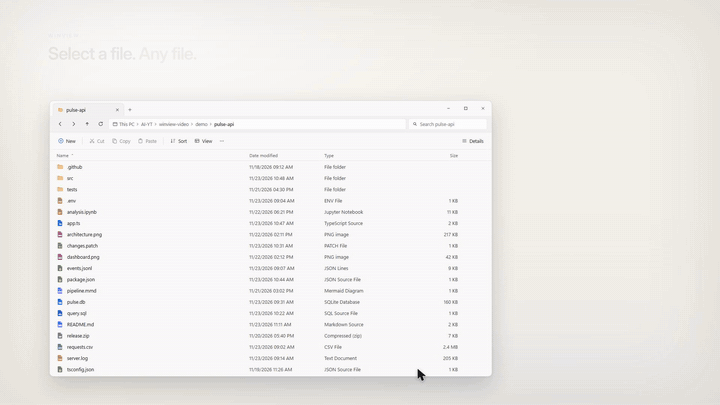

# WinView



Watch it with sound: [landscape](https://github.com/chirag-gamer/winview/releases/download/v0.1.0/winview-launch.mp4) or [vertical](https://github.com/chirag-gamer/winview/releases/download/v0.1.0/winview-launch-vertical.mp4).

Press Space in Windows Explorer and get an instant, offline preview of the selected file. WinView is a Windows version of the macOS Gander app, built with Tauri 2 and Rust.

## What it does

- Select any file in Explorer or on the Desktop, press the trigger key (default Space) and a non-activating popup shows a rich preview without stealing focus. Arrow keys keep navigating; the popup follows.
- Two trigger modes: Toggle (press to open, press again to close) or Hold (visible only while the key is down).
- Renders fully offline, nothing ever leaves your machine.

## Supported previews

| Type | Details |
|------|---------|
| Markdown | GitHub flavoured with tables, task lists, alerts, footnotes, emoji, Mermaid diagrams and KaTeX math |
| Code and configs | 30+ languages via syntect, toggling line numbers, per block copy buttons |
| JSON, JSONC, JSONL | Tree and Raw views with key order and big number precision preserved |
| CSV, TSV, TAB, PSV | Grid with separator detection, right aligned numbers, streaming up to 200,000 rows |
| SQLite | Read only Structure and Content tabs, no journal files created |
| Logs | Tail first, level colours, JSON line highlighting, errors and warnings filter |
| .env | Masked by default with SECRET badges, values reveal only on click |
| SQL | Formatted clause view with round trip verification, unsafe scripts fall back to Raw |
| Notebooks | Jupyter cells, saved outputs, ANSI tracebacks, Script tab |
| Archives | zip, tar, tar.gz listings without extraction, bounded against zip bombs |
| XML and plist | Tree views, binary plists included |
| Media | Images, PDF, audio and video streamed locally with range support |

## Privacy

Zero networking. No telemetry, no accounts, no external fetches. Cloud only OneDrive files are never downloaded by previewing.

## Install

Download `WinView_0.1.0_x64-setup.exe` from the Releases page and run it. WebView2 is downloaded automatically if missing. The app runs without admin rights and shows a short first run wizard for trigger mode and hotkey.

## Building from source

Requires Rust (MSVC) and Node 20+.

```sh
pnpm install
pnpm tauri dev      # run in development
pnpm tauri build    # produce the NSIS installer
```

## License

MIT
